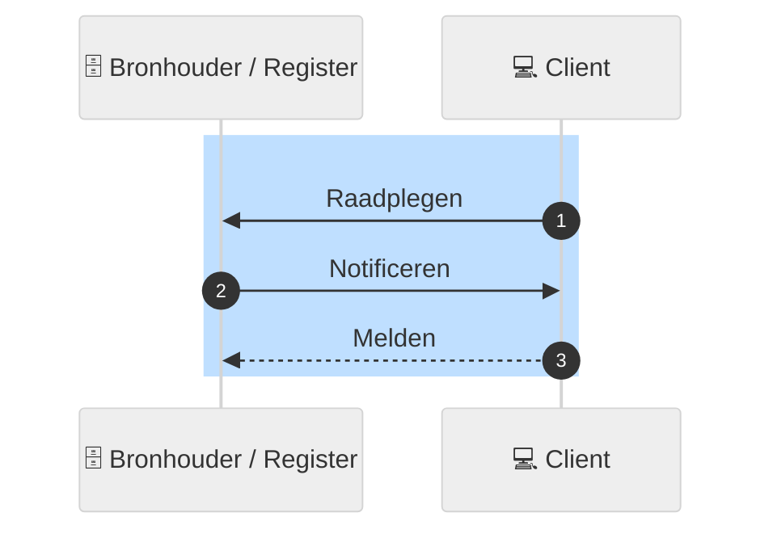

# Koppelvlakspecificaties Netwerkmodel

## Inleiding

In het netwerkmodel is er een *bronhouder* met een *register* waar een *client* informatie kan ***(1) raadplegen***. Deze raadpleging kan de client uitvoeren naar aanleiding van het ***(2) notificeren*** door een bronhouder van een bepaalde gebeurtenis die relevant is voor de ontvanger van een *notificatie*. Andersom, wanneer een raadpleger de bronhouder van relevantie informatie op de hoogte stellen, verloopt dat via ***(3) Melden***

Figuur 1 - Overzicht actoren en basis acties netwerkmodel

Technisch verloopt het raadplegen en notificeren en melden met [GraphQL](https://graphql.org). Hiervoor zijn **koppelvlak-specificaties** opgesteld. De documentatie van deze koppelvlak-specificaties is hier te vinden. 

## Leeswijzer Koppelvlakspecificaties
Ga eerst naar de [**LEESWIJZER**](./leeswijzer/index.md) voor de algemene toelichting over hoe de documentatie is opgebouwd en wat elk onderdeel beschrijft.

## Andere onderdelen Netwerkmodel iWlz
De koppelvlak-specificatie maken onderdeel uit van de specificaties van het Netwerkmodel iWlz. De documentatie van andere onderdelen die samen het Netwerkmodel iWlz vormen zijn:

-   :material-file-sign:{ .lg .middle } __Afsprakenstelsel iWlz__

    ---

    Het afsprakenstelsel heeft als doel deelnemers aan het iWlz-netwerkmodel op een uniforme en eenduidige wijze te informeren over de geldende afspraken, procedures en regels. Het vormt daarmee de basis voor samenwerking en gegevensuitwisseling binnen het iWlz-netwerkmodel.

    [lees verder](https://istandaarden.github.io/Afsprakenstelsel-iWlz/)

-   :material-monitor-dashboard:{ .lg .middle } __Informatiemodel iStandaarden__

    ---

    In het Informatiemodel iStandaarden liggen de specificaties voor de registers vast. Het model biedt een totaaloverzicht van de lopende releases en ziet u welke releases in ontwikkeling zijn.

    U vindt er ook de informatiemodellen van de iWmo, iJw, iEb en iPgb.

    [lees verder](https://informatiemodel.istandaarden.nl/)

## Meer informatie

-   :material-information-outline:{ .lg .middle } __Portaal voor iStandaarden in de Zorg en Ondersteuning__

    ---

    Alles over **iStandaarden**: van beheer, governance en samenwerking met de keten tot het informatiemodel voor veilige en eenduidige gegevensuitwisseling in de zorg.

    [lees verder](https://www.istandaarden.nl)

-   :material-lan:{ .lg .middle } __Het Netwerkmodel__

    ---

    Het Netwerkmodel iWlz vervangt het huidige berichtenverkeer binnen de Wlz. Gegevens blijven bij de bron en zijn beschikbaar voor geautoriseerde partijen: betrouwbaar en actueel. Lees er meer over op de website van iStandaarden.

    [lees verder](https://www.istandaarden.nl/algemeen/map/netwerkmodel)

 

---

[Terug](https://istandaarden.github.io/current/) naar *Aanvullende documentatie Netwerkmodel*
